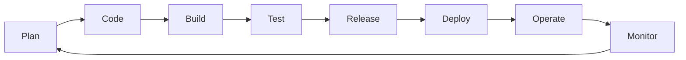

# 👋 Hi, I'm Shivprasad Vishwanath Suryakar

### 🚀 Aspiring DevOps Engineer | Cloud Enthusiast | MCA Student

 

&nbsp;&nbsp;&nbsp;

&nbsp;&nbsp;&nbsp;

---

## 👨‍💻 About Me 

I am an MCA student passionate about **DevOps, Cloud Computing, Automation, and Infrastructure Management**. I enjoy learning modern technologies and understanding how applications are developed, deployed, monitored, and maintained.

- 🎓 MCA (2025–2027)
- 🎓 BCS (2022–2025)
- 🐧 Interested in Linux System Administration.
- 🐳 Exploring containerization with Docker.
- ☸️ Learning Kubernetes and container orchestration.
- 🔄 Interested in CI/CD and GitOps workflows.
- ☁️ Exploring AWS Cloud Infrastructure.

## 🛠️ DevOps Tools & Technologies

### ☁️ Cloud Platforms

### 🐧 Operating Systems

### 🐳 Containerization & Orchestration

### 🔄 CI/CD & GitOps

### 📊 Monitoring & Observability

### 💻 Programming & Scripting

### 🗄️ Database & Web Technologies

## 🔁 DevOps Lifecycle

---

## 🎯 Career Interests

- DevOps Engineering
- Cloud Engineering
- Site Reliability Engineering (SRE)
- Kubernetes Administration
- Cloud Infrastructure Automation

---

## 🤝 Connect With Me

&nbsp;&nbsp;

&nbsp;&nbsp;

&nbsp;&nbsp;

---

### 💡 Learn | Build | Automate | Deploy

**"Automating today, innovating tomorrow."**

